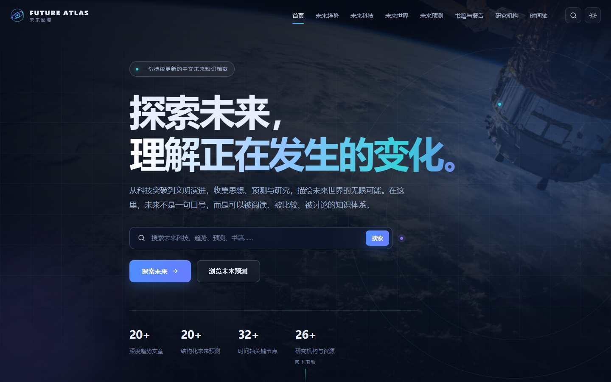
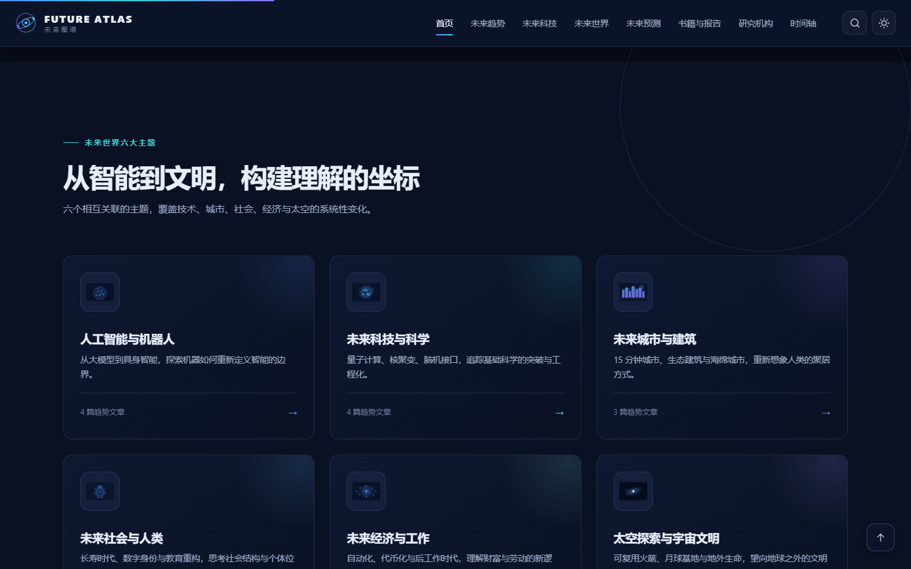
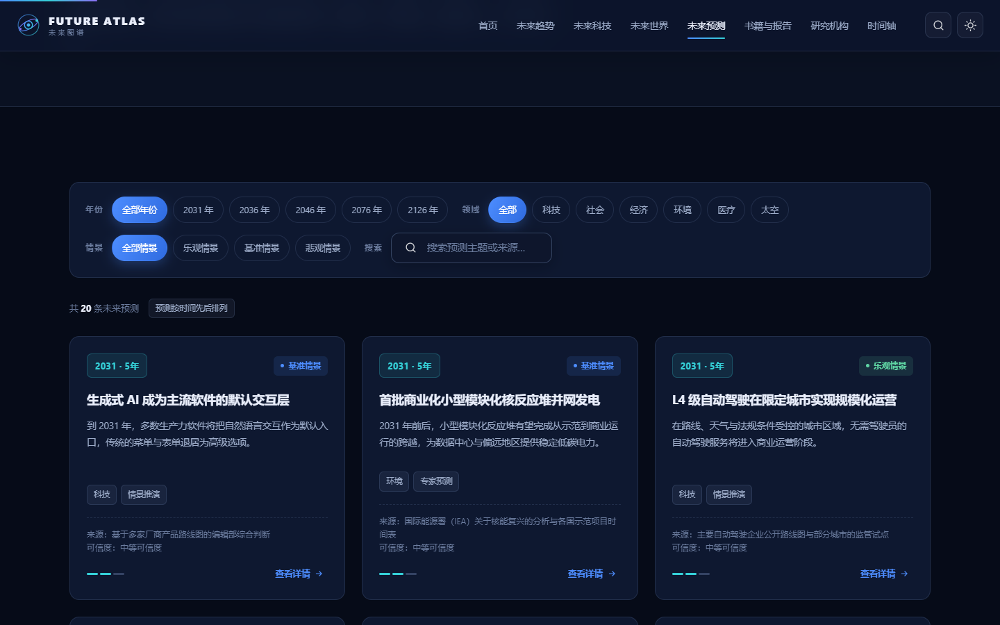
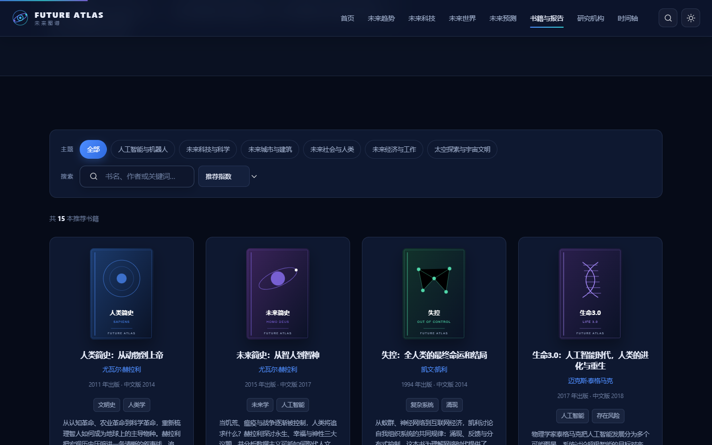
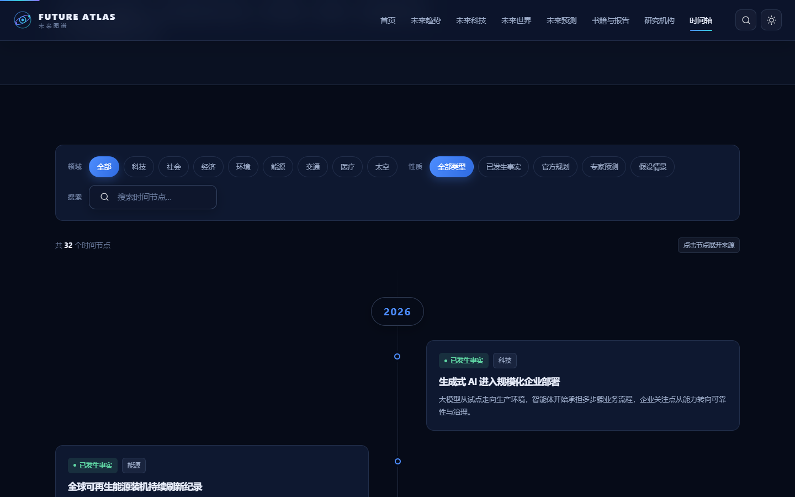
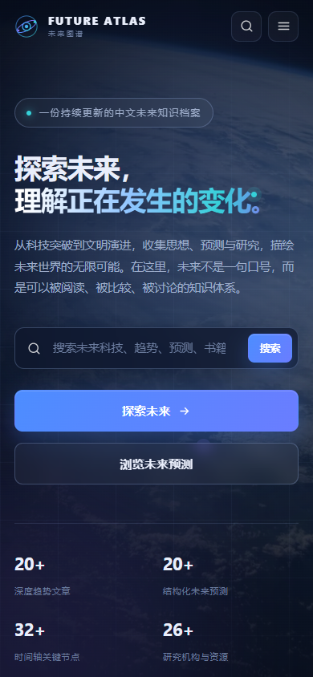
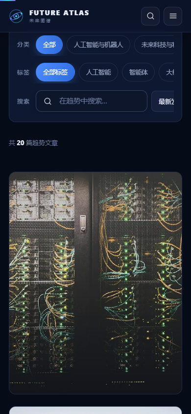

# Future Atlas（未来图谱）

一个面向中文读者的未来知识门户。收集、整理并展示未来趋势、未来预测、未来科技、未来城市、未来社会、未来经济与太空文明相关内容。以科技杂志的编辑标准组织信息，强调来源、语境与不确定性。

> 原生 HTML5 + CSS3 + JavaScript，无需框架、无需 npm、无需构建工具。

---

## 界面预览

### 首页



| 今日未来观察 | 未来世界六大主题 |
| :---: | :---: |
|  |  |

### 内容页面

| 未来预测（来源、情景与不确定性） | 未来学书籍（原创 SVG 封面） |
| :---: | :---: |
|  |  |



### 移动端适配

| 首页 | 趋势列表 |
| :---: | :---: |
|  |  |

---

## 快速开始

### 方式一：直接打开

双击 `index.html`，或把它拖入现代浏览器即可浏览。站点数据在 `assets/js/data.js` 中以 JS 对象内联，因此不依赖本地服务器，也不会触发 `file://` 下的跨域限制。

### 方式二：本地服务器（推荐用于开发）

```bash
python -m http.server 8080
```

然后访问 `http://localhost:8080`。

### 部署

纯静态站点，可直接部署到 GitHub Pages、Netlify、Vercel、Cloudflare Pages 或任意静态托管服务，把仓库根目录作为发布目录即可。无需设置构建命令。

---

## 页面清单

| 页面 | 说明 |
| --- | --- |
| `index.html` | 首页：Hero、今日未来观察、六大主题、预测精选、时间轴、书籍、资源、深度专题 |
| `trends.html` | 趋势列表：分类/标签筛选、排序、搜索、加载更多 |
| `predictions.html` | 未来预测：年份/领域/情景筛选，详情弹层，来源与不确定性说明 |
| `books.html` | 未来学书籍：主题筛选、搜索、排序 |
| `resources.html` | 研究机构与网站：类型筛选、官网与第三方资料区分 |
| `timeline.html` | 交互式时间轴：2026—2100，领域与性质筛选，节点可展开 |
| `article.html?id=…` | 文章详情：目录跳转、核心要点、相关预测与书籍、收藏 |
| `about.html` | 关于本站：定位、内容方法、素材来源、免责声明 |

站内所有内容卡片均链接到对应详情页，没有装饰性的无效按钮。

---

## 功能

- 全站搜索（`Ctrl/Cmd + K` 或导航栏搜索按钮），覆盖文章、预测、书籍、机构、专题与时间轴
- 分类筛选、标签筛选、多字段排序、无结果提示与空状态
- 交互式时间轴，点击节点展开来源与延伸阅读
- 移动端汉堡菜单
- 深色 / 浅色主题切换（localStorage 记忆，无闪烁）
- 返回顶部、阅读进度条、文章目录高亮跳转
- 收藏功能（localStorage）
- 图片懒加载、WebP 格式、语义化 HTML、Open Graph 信息
- 响应式布局，支持 PC / 平板 / 手机，无横向溢出
- 尊重 `prefers-reduced-motion`

---

## 目录结构

```
future-atlas/
├── index.html / trends.html / predictions.html / books.html
├── resources.html / timeline.html / article.html / about.html
├── assets/
│   ├── css/       style.css（设计系统与布局）、components.css（组件）、responsive.css（响应式）
│   ├── js/        data.js（内联数据，自动生成）、main.js、search.js、filters.js、timeline.js、theme.js
│   ├── images/    WebP 摄影图片（本地，来源见 IMAGE-SOURCES.md）
│   ├── icons/     原创 SVG 插画、UI 图标、书籍封面、品牌标志
│   └── fonts/     预留目录（使用系统字体栈，无外部字体文件）
├── data/          articles.json、predictions.json、books.json、resources.json、timeline.json
├── tools/         内容生成与图片处理脚本（开发用，运行时不依赖）
└── IMAGE-SOURCES.md
```

---

## 维护与更新内容

所有内容集中存放在 `data/*.json`，修改后重新生成内联数据文件：

```bash
node tools/build-data.js
```

`assets/js/data.js` 由脚本生成，请勿直接编辑。它把 JSON 内容内联为 `window.AtlasData`，这样直接以 `file://` 打开页面时也能正常工作。

如需修改页面骨架（导航、页脚、页面结构），编辑 `tools/gen-pages.js` 后运行：

```bash
node tools/gen-pages.js
```

其它工具脚本：

```bash
node tools/gen-svgs.js        # 重新生成插画与 UI 图标
node tools/gen-bookcovers.js  # 重新生成书籍封面插画
python tools/to-webp.py       # 将 assets/images 下的 JPG 转为 WebP
```

---

## 内容规模

- 20 篇趋势文章（含正文分节、核心要点、配图）
- 20 条未来预测（含来源、发布时间、预测者、证据、不确定性、三种情景）
- 15 本真实出版物（含作者、出版年份、简介、推荐理由）
- 26 个研究机构与网站（含中文简介、研究方向、官网入口）
- 8 个深度专题
- 32 个时间轴节点（2026—2100，四类身份标签）

书籍、机构与网站均为真实存在的对象。预测中的推演内容明确标注为「情景推演」或「假设情景」，没有被写成既成事实。

---

## 许可证与来源

- 摄影图片：Unsplash License，详见 [`IMAGE-SOURCES.md`](IMAGE-SOURCES.md)。
- SVG 插画、UI 图标、书籍封面、品牌标志：本项目原创，可随项目使用。
- 内容：编辑部原创解读；引用的公开报告与数据归属原作者与发布机构，见各条目来源字段与 `about.html`。

---

## 浏览器兼容

面向现代浏览器：Chrome / Edge / Firefox / Safari 最近两个大版本。使用 CSS Grid、Flexbox、CSS Variables、`IntersectionObserver` 与 `URLSearchParams`；未提供 IE 支持。
